<p align="center">
  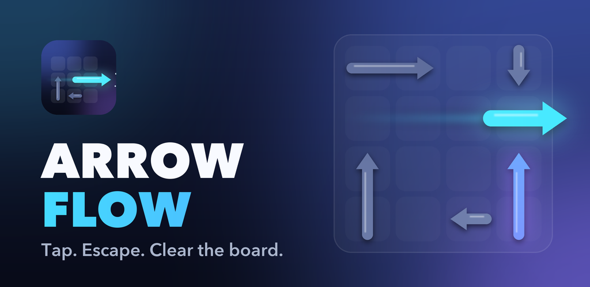
</p>

<h1 align="center">
  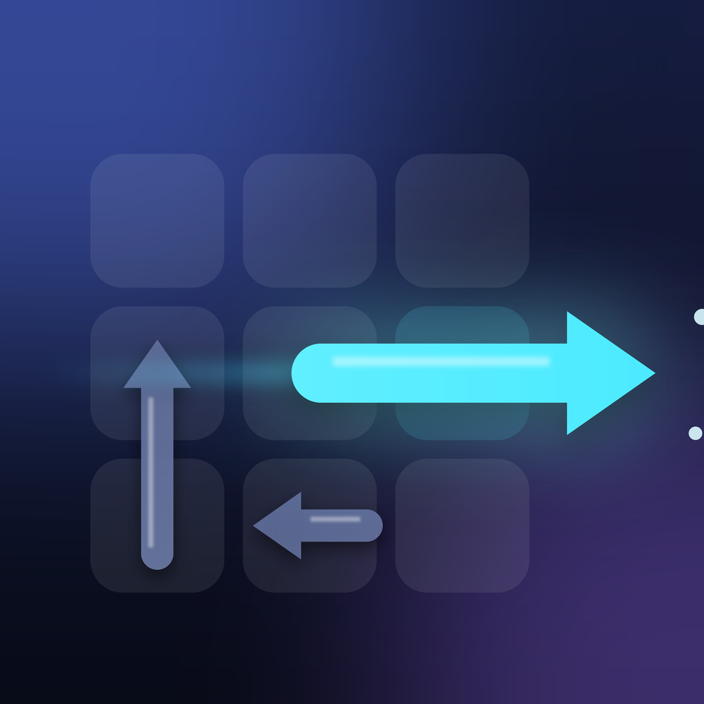
  Arrow Flow: Arrow Puzzle
</h1>

<p align="center">
  <b>Tap. Escape. Clear the board.</b><br>
  An original arrow-escape logic puzzle for Android and iOS, built with Flutter.
</p>

<p align="center">
  Flutter 3.47 · Dart 3.13 · Android + iOS · Package <code>com.qurat.arrowpuzzle.game</code>
</p>

---

## About the game

Every arrow points in one direction. An arrow can leave the board only when nothing stands in its path. Find the arrow that's free, tap it, and watch it fly away. Each escape opens new paths until the whole board is clear.

- **Rules:** easy to learn in seconds, with 1,200+ levels that get harder as you go.
- **Every board is solvable:** a solver checks every level.
- **Feel:** smooth arrow flights, glowing trails, particle sparks, haptics and soft sound.
- **Offline:** everything works without internet. Only the ads need a connection.

The name, logo, palette, art, sounds and levels are all original. The game shares only the general mechanic of the arrow-escape genre. To rename it, edit `lib/core/constants/app_info.dart`.

## Screenshots

| Gameplay | Combos | Daily Challenge | Tower 2.5D |
|:---:|:---:|:---:|:---:|
| 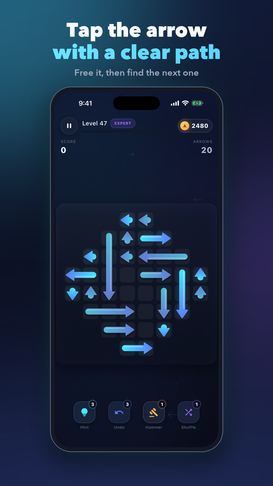 | 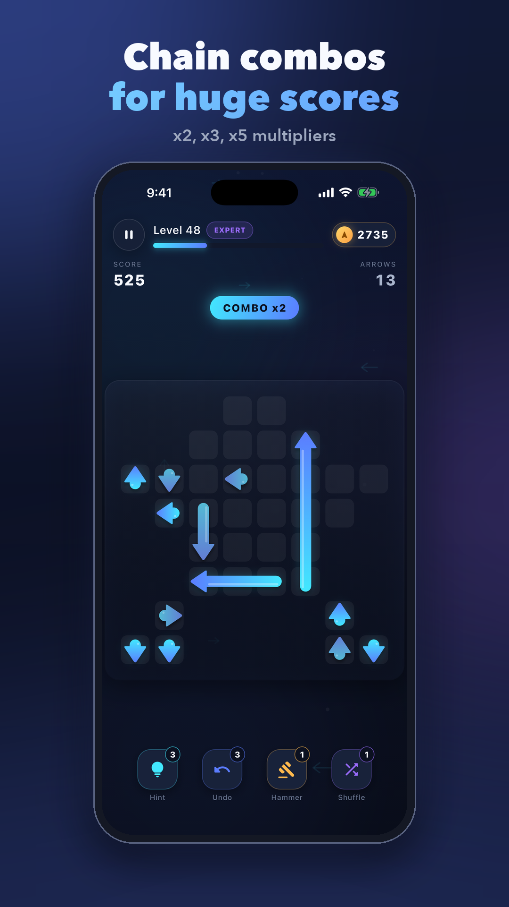 | 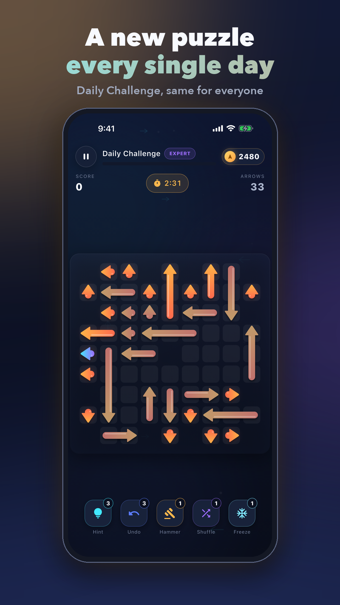 | 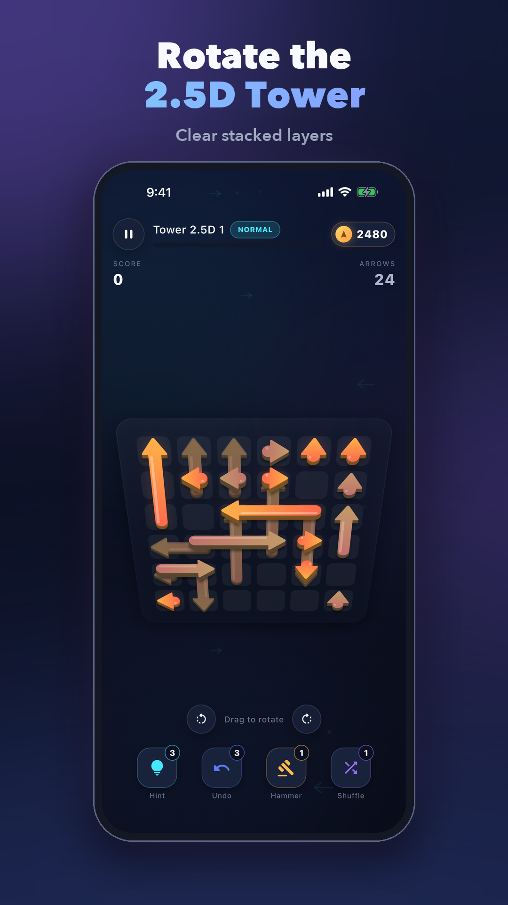 |
| **Level Complete** | **Level Map** | **Skins & Themes** | **Boosters** |
| 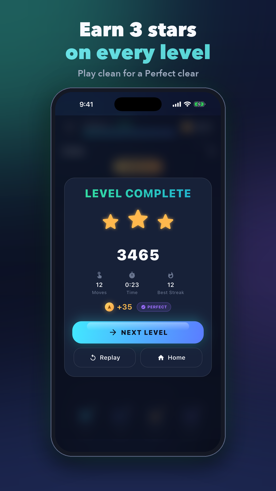 | 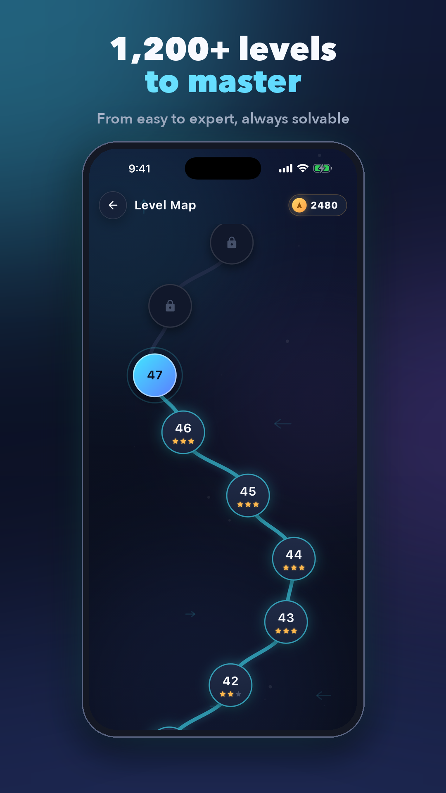 | 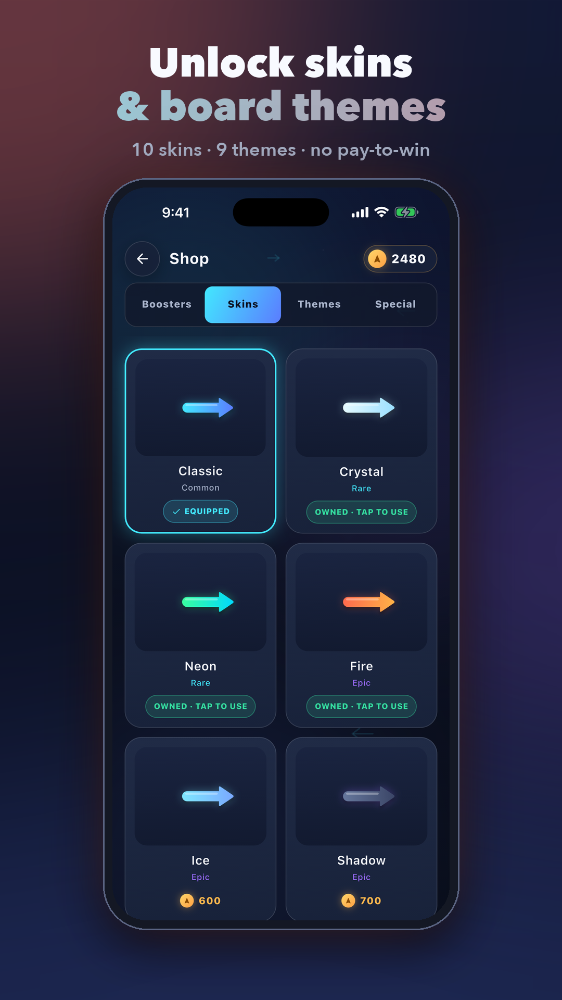 | 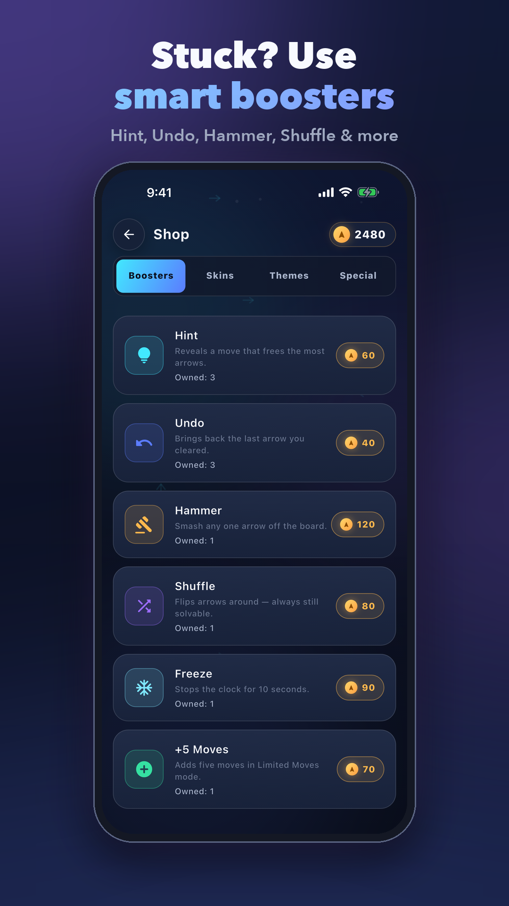 |

<details>
<summary>Raw in-game captures (iPhone 17 Pro Max)</summary>

| Home | Daily | Expert board | Shop |
|:---:|:---:|:---:|:---:|
| 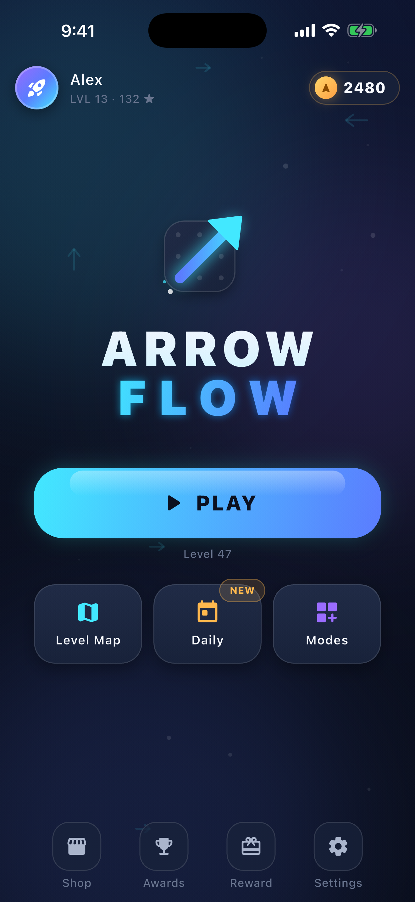 | 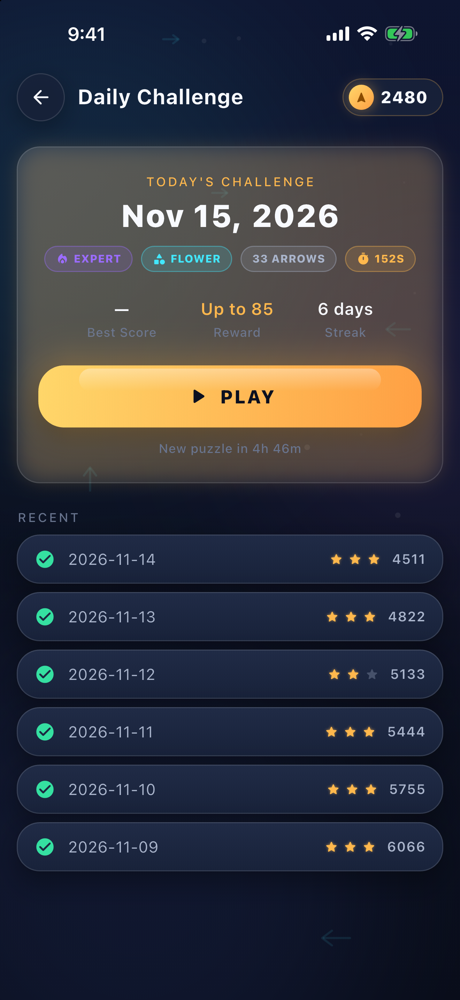 | 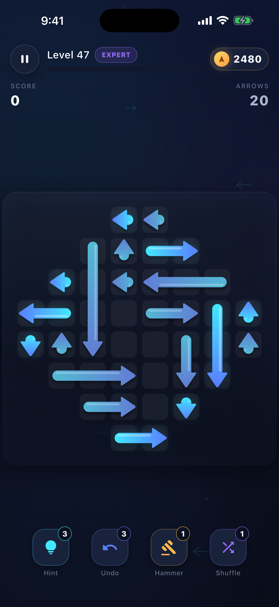 | 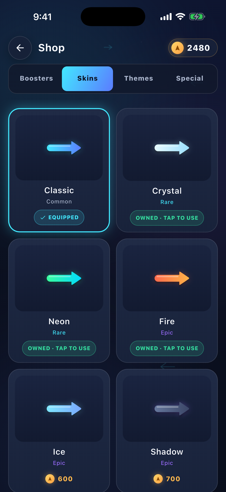 |

</details>

## Store assets

| Asset | Size | Path |
|---|---|---|
| App icon (App Store) | 1024×1024 | `store/branding/app_icon_1024.png` |
| Play Store icon | 512×512 | `store/branding/play_store_icon_512.png` |
| Feature graphic | 1024×500 | `store/google_play/feature_graphic_1024x500.png` |
| Play screenshots | 1080×1920 ×8 | `store/google_play/screenshots/` |
| App Store 6.9" screenshots | 1320×2868 ×8 | `store/app_store/screenshots_6.9/` |
| App Store 6.5" screenshots | 1284×2778 ×8 | `store/app_store/screenshots_6.5/` |
| Listing text, categories, privacy answers | | [`store/STORE_LISTING.md`](store/STORE_LISTING.md) |

**Categories:** Google Play is Game › Puzzle. App Store is Games › Puzzle, with Games › Casual as secondary. Age rating is Everyone / 4+.

## Run

```bash
flutter pub get
flutter run
```

```bash
flutter test          # 60 tests: engine, solver, generator (all 1,200 campaign levels), scoring, session, persistence, ad frequency
flutter analyze       # clean
```

## Architecture

```
lib/
  core/          constants, theme tokens (AppColors/Gradients/Shadows/TextStyles/Spacing/Radius/Durations), utils, extensions
  models/        ArrowData, LevelData, BoardShape, GameMode, Booster, cosmetics, PlayerProgress, AppSettings, achievements
  game/
    board/       BoardState (logic), BoardLayout (cell↔pixel), BoardPainter (rendering)
    arrows/      ArrowRenderer (dimensional arrow drawing)
    collision/   CollisionDetector (path + layer cover checks)
    solver/      PuzzleSolver (legal moves, solve, deadlock, hint, solution count), DifficultyRater
    generator/   LevelGenerator (seeded, solvable-by-construction, solver-verified)
    levels/      LevelCatalog (campaign / endless / daily / tower / challenge), curated_levels.dart
    effects/     BoardEffects (animation state), ParticleSystem (pooled)
    engine/      GameSession (game state), Scoring
  state/         ProgressController, SettingsController (ChangeNotifier + provider)
  repositories/  ProgressRepository (SharedPreferences impl + in-memory impl)
  services/      audio, haptics, analytics (interface), ads (AdMob, consent, frequency, banner)
  features/      home, level_map, gameplay, modes, daily_challenge, shop, achievements, settings, profile
  widgets/       buttons, glass panels, badges, dialogs, animated background, logo, switch
tool/            freeze_levels.dart, calibrate_generator.dart, generate_audio.py
```

### Key decisions

- **State management: `provider` + `ChangeNotifier`.** It's small, stable and easy to test. Game state lives in `GameSession`, one per level attempt. Meta state (coins, stars, cosmetics) lives in `ProgressController`. Visual-only animation state lives in `BoardEffects`. These three never mix.
- **Rendering: one `CustomPainter` for the whole board**, so there is no widget per arrow. Arrows that aren't animating are recorded into a cached `ui.Picture`, and each frame only redraws animating arrows, trails and pooled particles. Flame isn't needed.
- **Solver is exact and fast.** Removing an arrow only ever frees cells. So a puzzle is solvable exactly when greedily removing any free arrow clears the board. Deadlocks, hints (the move that frees the most arrows) and difficulty metrics all come from this.
- **The generator is solvable by construction, then verified.** It places each new arrow only if that arrow's own escape path is currently clear, so reverse placement order is always a solution. For harder difficulties it prefers placements that deepen the blocking chain. Every candidate still runs through the solver and a difficulty band check. If no candidate lands in the band, the closest solvable candidate ships.
- **Levels:** 1–3 are hand-authored tutorials. 4–50 are hand-picked generator configs frozen to data by `tool/freeze_levels.dart`, so they never change. Levels 51–1200 are generated deterministically from `seed + config` with no stored data. A test verifies all 1,200 are solvable. The daily challenge seed is `YYYY-MM-DD`.

## Features

- **Modes:** Classic, Timed, Limited Moves, Perfect, Endless, Daily Challenge and Tower 2.5D (tilted board you can rotate, with two stacked layers where upper arrows cover lower ones).
- **Game feel:**
  - Escapes go through anticipation, an accelerating flight and a glowing trail, then end in directional sparks with a slight board pulse, a floating score, a haptic and a sound.
  - Blocked taps slide the arrow up to its blocker, bounce back with a coral tint and flash the blocker.
- **Boosters:** Hint, Undo, Hammer, Shuffle (always stays solvable), Freeze and +5 Moves.
- **Economy and rewards:** combo multipliers (x2/x3/x5), speed/efficiency/perfect bonuses, 1–3 stars and coins.
- **Cosmetics:** 10 skins and 9 themes. They are cosmetic only.
- **Retention:** a 7-day login reward, 13 achievements, a profile screen and an interactive tutorial.
- **Settings:** music, SFX, haptics, graphics quality, reduce motion, free-arrow highlight, privacy options and reset.

## Ads (AdMob)

- **Test IDs only.** All IDs are Google's official test IDs. Ad unit IDs live in `lib/services/ads/ad_config.dart`. The App IDs live in `AndroidManifest.xml` and `ios/Runner/Info.plist`. Replace both before release.
- **Banners** appear on Home, Level Map and Shop only, never during gameplay.
- **Interstitials** show at most every 3 completed levels with at least 90 seconds between them. They never show during the tutorial or in the first 60 seconds after launch, and only appear on Next/Home/Replay.
- **Rewarded ads** grant the reward only from `onUserEarnedReward`.
- **Failures are safe.** Every failure path (offline, no fill, init error) leaves the game playable, and rewarded loads time out after 8 seconds.
- **Consent** goes through UMP and sits behind a `ConsentService` interface. `adsEnabled` is ready for a future Remove Ads purchase. No payments are implemented.

## Assets

- **Sounds and music** in `assets/sounds` and `assets/music` are synthesized by `tool/generate_audio.py`, so there are no third-party licenses.
- **Font:** the app uses the platform font. To bundle a display font, add it under `assets/fonts/`, declare it in `pubspec.yaml` and set `AppTypography.family`.

## Store release

- **Package and bundle ID:** `com.qurat.arrowpuzzle.game` on both platforms. The iOS build is iPhone-only and portrait-only.
- **Store assets:** listing text, categories and privacy answers are in [store/STORE_LISTING.md](store/STORE_LISTING.md), next to the icons, the feature graphic and the framed screenshots.
- **Regenerating assets:** run the Pillow scripts in `tool/store_assets/` (`make_icon.py`, `make_feature_graphic.py`, `make_screenshots.py`).
- **Screenshot mode:** to capture new raw screenshots with demo progress and no ads, run:
  ```bash
  flutter run --dart-define=SCREENSHOT_MODE=true
  ```
- **Android signing:** copy `android/key.properties.example` to `android/key.properties` and fill it in. Then build:
  ```bash
  flutter build appbundle --release
  ```
- **iOS:** set your Team in Xcode, then build:
  ```bash
  flutter build ipa --release
  ```

## Known gaps

- The **Notifications** setting is stored, but nothing schedules reminders yet. That needs a local-notifications plugin.
- The **music loop** timed out starting on the iOS simulator. The sound-effect pools loaded without errors. Check both on a real device.